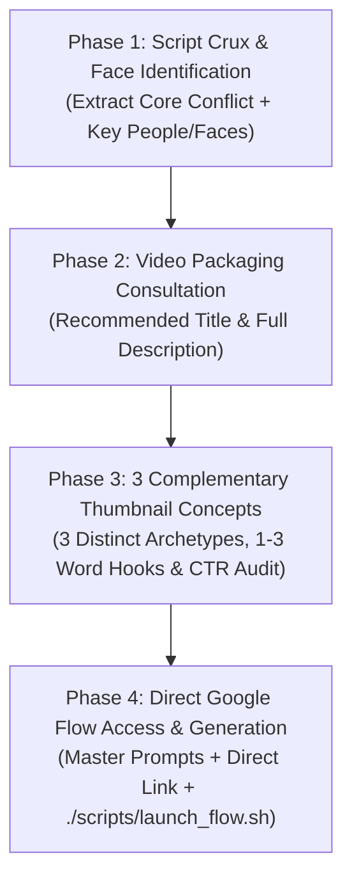

# Universal YouTube Packaging & Thumbnail Engine

A platform-agnostic YouTube packaging and visual art direction system designed to work seamlessly across **any coding agent or CLI** (Claude Code, OpenAI Codex, OpenCode, Cursor, Gemini CLI, or Antigravity).

It eliminates guesswork by taking raw scripts, identifying the real human faces to anchor the visual, generating production-ready SEO metadata, formulating 3 complementary thumbnail concepts, and giving creators direct access to **Google Flow** with tailored **Nano Banana Pro** prompts.

> [!IMPORTANT]
> **Universal Agent Operating Guidelines**:
> - **Do NOT call proprietary image generation subagents.** This skill must run identically in Claude, Codex, OpenCode, or any CLI.
> - **Non-Intrusive Background Principle**: Never hijack the user's screen, steal active window focus, or lock the mouse cursor. All local operations, asset extractions, and queueing must run quietly in the background so the user can continue their work undisturbed.
> - **Zero-Repetition Prompting**: Eliminate redundant/repetitive words in prompts. Enforce single-instance text constraints so AI models never generate duplicated words or twin badges (e.g., forbidding repeated text stamps like `TRAPPED TRAPPED`).
> - **High-CTR Beauty & Clickability Gate**: Every concept must pass rigorous visual beauty, emotional tension, and 1-inch mobile preview standards before release.
> - **Follow the 4-Phase Flow**:
>   1. **Understand Script & Identify Faces**: Find the real figures and their emotional postures.
>   2. **Present Title & Description**: Deliver high-CTR SEO title and structured description.
>   3. **Present 3 Complementary Thumbnail Concepts**: 3 distinct archetypes with 1–3 word hooks and beauty audit.
>   4. **Give Direct Google Flow Access**: Provide copy-paste Nano Banana Pro prompts, direct clickable links, and one-click launch script.

---

## The Standard 4-Phase Universal Flow



---

## Phase 1: Script Crux & Face Identification

When a user provides a script, outline, or topic:
1. **The Core Paradox**: Extract what hidden reality, contradiction, or institutional crisis is being exposed.
2. **Face & Subject Identification**: Scan the script and identify the specific real people/figures whose faces should anchor the thumbnail:
   - *Primary Face*: (e.g. Jensen Huang, Dhirubhai Ambani, Elon Musk, Takashi Kotegawa, Mark Zuckerberg, anonymous smartphone user).
   - *Secondary Face / Silhouette*: (e.g. Alice Huang / Megaspeed, corporate rival, investigator, algorithmic shadow).
   - *Emotional Posture*: Specify their exact psychological posture (calculating, skeptical, cornered, stoic, hollowed-out, conflicted—never cartoonish shouting).

---

## Phase 2: Video Title & Description Recommendation

Present the finalized SEO metadata to the user:
1. **Recommended Title**: High-CTR, search-optimized title balancing browse curiosity with search intent.
2. **High-Retention Description**:
   - First 2 lines SEO hook (above the fold).
   - Chapter timestamp outline.
   - Key findings bullet points.
   - Sources & citations block.
   - Categorized hashtags (`#...`).

---

## Phase 3: Three Complementary Thumbnail Concepts & Quality Gate

Offer 3 distinct thumbnail concepts that approach the video's core idea from complementary psychological angles:

| Concept | Visual Archetype | 1–3 Word Hook | Visual Composition |
| :--- | :--- | :--- | :--- |
| **Concept 1** | **The Tactical Dossier** | `WHO KNEW?` / `THE TRAP` | Manila folder, black redaction bars, paperclips, candid photo, physical chip. |
| **Concept 2** | **Halftone Screenprint** | `YOU ARE THE PRODUCT` | Newsprint halftone raster dots, cream paper, blood red typography behind subject. |
| **Concept 3** | **Tactile Collage / Casino** | `THE CASINO` / `EXPOSED?` | Distressed mixed media, 3D slot machine reels, torn portrait, red hazard tape. |

### The High-CTR Beauty & Clickability Gate

Every concept must pass this 5-point quality gate:
1. **1-Second Mobile Glancibility**: Can a mobile user scrolling at high speed understand the subject and hook in <1.2 seconds?
2. **Curiosity Gap vs. Cheap Clickbait**: Does the juxtaposition of visual elements create an unanswered tension that compels a click without misleading the audience?
3. **Aesthetic Elegance & Color Harmony**: Strict 2–3 color harmony (e.g. Deep Charcoal `#121212` + Vintage Cream `#F4EFEA` + Crimson Red `#C8102E`). Avoid oversaturated rainbow clutter.
4. **Zero Word Repetition**: Verify that no word or phrase repeats anywhere on the graphic canvas or badges.
5. **Authentic Facial Gravitas**: Deep, pensive, conflicted, or stoic human emotion. Zero cartoonish YouTuber open-mouth faces.

*For full visual specifications of all archetypes, see [references/archetypes.md](./references/archetypes.md).*

---

## Phase 4: Direct Google Flow Access & Generation

For the chosen concept(s), provide the creator with immediate, friction-free access to **Google Flow**:

1. **The Master Google Flow (Nano Banana Pro) Prompt**:
   A comprehensive, paragraph-length prompt adhering to the 7-element formula with explicit anti-repetition directives:
   ```text
   [Cinematic 16:9 Medium] + [Identified Subject & Pensive Emotion] + [Chiaroscuro & Colored Rim Light] + 
   [Tactile Materiality: Manila/Burlap/Twine/Halftone] + [Negative Space for Text] + 
   [Color Discipline: Ivory #F4EFEA + Crimson Red #C8102E + Charcoal #121212] + 
   [Text Constraint: The text '[HOOK]' appears EXACTLY ONCE on the visual element. Strictly forbid duplicate words, repeating label tags, repeating badges, or double text stamps.] +
   [Camera Optics: Hasselblad H6D / 50mm f/2.8 & Natural Film Grain]
   ```

2. **Direct Clickable Link**:
   Provide a direct Markdown link so the user can open Google Flow in one click:
   👉 **[Open Google Flow](https://labs.google/flow)**

3. **One-Click Cross-Platform Launch Script**:
   Instruct the user that they can run the included launcher script:
   ```bash
   ./scripts/launch_flow.sh prompt.txt
   # Or using Python (zero-dependency on Mac/Windows/Linux):
   python3 ./scripts/launch_flow.py prompt.txt
   ```
   *(Copies the prompt directly to system clipboard and opens the browser automatically without disrupting active work)*.
