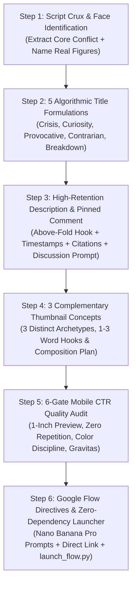

# YouTube All-Rounder 🎬🚀

The ultimate platform-agnostic YouTube packaging, title engineering, description architecture, and thumbnail visual art direction system designed to work seamlessly across **any coding agent or CLI** (Claude Code, OpenAI Codex, OpenCode, Cursor, Gemini CLI, or Antigravity).

It eliminates guesswork by taking raw scripts, outlines, or ideas and delivering a **complete, production-grade packaging suite** ready for maximum algorithmic distribution, high click-through rates (CTR), and deep audience retention.

> [!IMPORTANT]
> **Universal Agent Operating Guidelines**:
> - **Zero External Dependencies**: All helper scripts run on standard, built-in tools (Python standard library + POSIX shell). No proprietary APIs or heavy packages required.
> - **Do NOT call proprietary image generation subagents.** This skill is 100% universal and platform-agnostic.
> - **The Non-Intrusive Background Principle**: Never hijack the user's screen, steal active window focus, or lock the mouse cursor. Local operations and launchers must run quietly in the background.
> - **Zero-Repetition Prompting**: Eliminate redundant or repetitive words. Enforce strict single-instance text constraints so AI models never generate duplicated words or twin badges (e.g. forbidding repeated stamps like `TRAPPED TRAPPED`).
> - **High-CTR Beauty & Clickability Gate**: Every concept must pass rigorous visual beauty, emotional gravitas, and 1-inch mobile preview standards before release.

---

## The Standard 6-Step All-Rounder Flow



---

## Step 1: Script Crux & Face Identification

When a user provides a script, outline, or topic:
1. **The Core Paradox**: Extract what hidden reality, contradiction, systemic crisis, or institutional friction is being exposed.
2. **Face & Subject Identification**: Scan the script and identify the specific real people/figures whose faces should anchor the thumbnail:
   - *Primary Face*: (e.g., Jensen Huang, Dhirubhai Ambani, Elon Musk, Takashi Kotegawa, Mark Zuckerberg, or anonymous worker/user).
   - *Secondary Face / Foil*: (e.g., corporate rival, government investigator, algorithmic shadow, whistleblower).
   - *Emotional Posture*: Specify their exact psychological posture (calculating, skeptical, cornered, stoic, hollowed-out, conflicted—never cartoonish YouTube open-mouth faces).

---

## Step 2: Algorithmic Title Engineering (5 Proven Angles)

Present 5 distinct title formulations balancing browse curiosity with search intent:

| # | Angle | Algorithmic Mechanism | High-CTR Formula | Example |
| :--- | :--- | :--- | :--- | :--- |
| **1** | **The Systemic Crisis** | High Stakes & Global Impact | `[Subject]'s [Crisis]: Why [Immense Consequence]` | *The Coming Data Center Power Crash* |
| **2** | **The Curiosity Gap** | Unanswered Investigative Tension | `The Hidden [System/Truth] Behind [Subject]` | *The Secret Economy Behind Your Attention* |
| **3** | **The Provocative Question** | Accusation & Urgent Inquiry | `Did [Subject] Just Break [System]?` | *Did the Internet Just Run Out of Space?* |
| **4** | **The Contrarian Truth** | Challenging Widely Held Beliefs | `Why [Common Belief] Is Actually a Lie` | *Why "Free" Apps Are Making Billions Off You* |
| **5** | **The Definitive Breakdown** | Authoritative Masterclass | `The [Subject] Scandal: Explained` | *The Business of Attention: Explained* |

---

## Step 3: High-Retention Description & Pinned Comment

Provide the creator with a ready-to-paste video metadata block:

1. **Above-the-Fold Hook (Lines 1–2)**: High-density summary optimized for Google search and YouTube mobile previews before the "Show More" fold.
2. **Structured Chapter Outline**: Full timestamps starting at `00:00`.
3. **Key Findings / Bullet Points**: 3–4 bulleted takeaways that deliver instant value.
4. **Research & Citations Block**: Official reports, filings, or industry data sources.
5. **Hashtags & Prioritized Tags**: Top 3 header hashtags (`#...`) plus high-volume search tags.
6. **Pinned Comment Recommendation**: A targeted, polarizing or thoughtful discussion question designed to drive high comment velocity in the first 24 hours (a key YouTube algorithmic ranking signal).

---

## Step 4: Three Complementary Thumbnail Concepts

Offer 3 distinct thumbnail concepts that approach the video's core idea from complementary psychological angles:

| Concept | Visual Archetype | 1–3 Word Hook | Visual Composition |
| :--- | :--- | :--- | :--- |
| **Concept 1** | **The Tactical Dossier** | `WHO KNEW?` / `THE TRAP` | Manila folder, black redaction bars, paperclips, candid photo, physical chip. |
| **Concept 2** | **Monumental Editorial Typography** | `OVERLOAD` / `CAGED` | Huge condensed woodblock typography layered *behind* the subject's head, chiaroscuro rim light. |
| **Concept 3** | **Halftone Screenprint / Tactile Collage** | `THE CASINO` / `OUT OF SPACE` | Risograph newsprint halftone raster dots, distressed cream paper, crimson red typography, physical props. |

*For full visual specifications of all 6 archetypes, see [references/archetypes.md](./references/archetypes.md).*

---

## Step 5: The 6-Gate Mobile CTR Quality Audit

Every concept must pass this rigorous quality gate before finalizing:
1. **1-Second Mobile Glancibility**: Can a mobile user scrolling at high speed understand the subject and hook in <1.2 seconds?
2. **Curiosity Gap vs. Cheap Clickbait**: Does the juxtaposition of visual elements create an unanswered tension that compels a click without misleading the audience?
3. **Aesthetic Elegance & Color Harmony**: Strict 2–3 color harmony (e.g. Deep Charcoal `#121212` + Vintage Cream `#F4EFEA` + Crimson Red `#C8102E`). Avoid oversaturated rainbow clutter.
4. **Zero Word Repetition**: Verify that no word or phrase repeats anywhere on the graphic canvas or badges.
5. **Authentic Facial Gravitas**: Deep, pensive, conflicted, or stoic human emotion. Zero cartoonish YouTuber reaction faces.
6. **Timestamp Safe Zone**: Critical text and hero focal points must remain completely clear of the bottom-right corner (where YouTube displays video duration).

*See full checklist at [checklists/thumbnail-audit-checklist.md](./checklists/thumbnail-audit-checklist.md).*

---

## Step 6: Direct Google Flow Access & Zero-Dependency Launcher

For the chosen concept(s), provide the creator with immediate, friction-free access to **Google Flow**:

1. **The Master Google Flow (Nano Banana Pro) Prompt**:
   A comprehensive prompt adhering to the 7-element formula with explicit anti-repetition directives:
   ```text
   [Cinematic 16:9 Medium] + [Identified Subject & Pensive Emotion] + [Chiaroscuro & Colored Rim Light] + 
   [Tactile Materiality: Manila/Burlap/Twine/Halftone] + [Negative Space for Text] + 
   [Color Discipline: Ivory #F4EFEA + Crimson Red #C8102E + Charcoal #121212] + 
   [Text Constraint: The text '[HOOK]' appears EXACTLY ONCE on the visual element. Strictly forbid duplicate words, repeating label tags, repeating badges, or double text stamps.] +
   [Camera Optics: Hasselblad H6D / 50mm f/2.8 & Natural Film Grain]
   ```

2. **Direct Clickable Link**:
   Provide a direct Markdown link so the user can open Google Flow in one click:
   👉 **[Open Google Flow](https://labs.google/flow)**

3. **One-Click Zero-Dependency Launch Script**:
   Instruct the user that they can run the included launcher script:
   ```bash
   python3 ./scripts/launch_flow.py prompt.txt
   # Or using Bash:
   ./scripts/launch_flow.sh prompt.txt
   # Or silent background copy mode (copies without opening browser):
   python3 ./scripts/launch_flow.py --copy-only prompt.txt
   ```
   *(Zero external pip dependencies required. Built with standard Python library)*.
