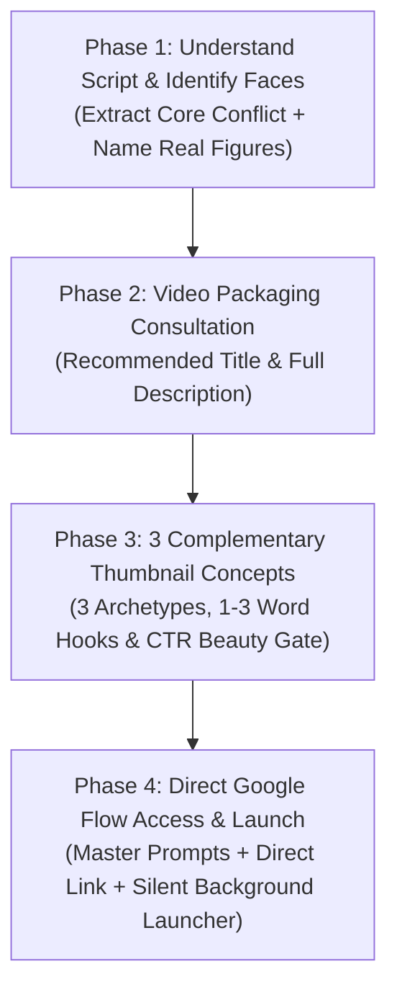

# Universal YouTube Packaging & Documentary Thumbnail Engine 🎬🔍

> An elite, platform-agnostic **AI Agent Skill & Complete YouTube Packaging System** designed for **Claude Code, OpenAI Codex, OpenCode, Cursor, Gemini CLI, and Antigravity**.

Takes any video script, analyzes the narrative tension, identifies the key human faces to anchor the visual, generates **SEO-friendly high-CTR titles and descriptions**, presents **3 complementary thumbnail concepts**, and gives creators **direct, one-click access to Google Flow** with hyper-detailed **Nano Banana Pro** prompts.

---

## 🌍 Works Across Any AI Coding Agent

This skill is 100% portable and does not rely on proprietary internal image generation tools. It works out of the box in:
*   🤖 **Claude Code** (`claude`)
*   💻 **OpenAI Codex / GPT CLI**
*   ⚡ **OpenCode**
*   🖱️ **Cursor IDE**
*   🔮 **Antigravity** (`agy`)
*   🛠️ **Any custom LLM tool runner**

---

## 🚀 The 4-Phase Agent Workflow



### 1. Understand Script & Identify Faces
The agent reads the script, finds the core paradox, and specifically extracts the **real human faces** (e.g. Jensen Huang, Alice Huang, Elon Musk, Mark Zuckerberg, or anonymous smartphone user) and their psychological posture (calculating, skeptical, stoic, hollowed-out).

### 2. Present Title & Description
Delivers a high-CTR SEO title and a high-retention video description with chapters, key findings, and citations.

### 3. Present 3 Complementary Thumbnail Concepts & Quality Gate
Gives the creator 3 distinct visual angles that approach the video's core idea from complementary psychological perspectives:
1. **The Tactical Dossier** (e.g. Hook: `THE TRAP` / `WHO KNEW?` — Classified case file, paperclips, red stamps).
2. **The Halftone Screenprint** (e.g. Hook: `YOU ARE THE PRODUCT` — Risograph newsprint halftone, blood red typography).
3. **The Tactile Collage / Casino** (e.g. Hook: `THE CASINO` — Distressed mixed media, 3D slot reels, torn portrait, red hazard tape).

#### The High-CTR Beauty & Clickability Gate:
*   **Zero Word Repetition**: Prompts strictly mandate single-instance text hooks to prevent AI hallucinations like double badges (`TRAPPED TRAPPED`).
*   **1.2-Second Mobile Glancibility**: Instant visual comprehension at 160px width.
*   **Curiosity Gap**: Irresistible visual tension without misleading clickbait.
*   **Color Discipline**: Restrained 2–3 color harmony (Charcoal, Ivory, Crimson Red).

### 4. Direct Google Flow Access & Generation
Gives the creator direct access to **Google Flow**:
*   A ready-to-paste **Nano Banana Pro Master Prompt** for each concept.
*   Direct clickable link to **Google Flow**: [https://labs.google/flow](https://labs.google/flow).
*   One-click cross-platform copy & launch script (`./scripts/launch_flow.sh` or `python3 ./scripts/launch_flow.py`).

---

## ⚡ Non-Intrusive Background Execution

The engine strictly respects user productivity:
*   Never steals window focus or freezes the user's cursor.
*   Supports `--copy-only` / `--background` modes in `launch_flow.py`.
*   Local asset extractions run silently from cache/direct downloads in the background.

```bash
# Using Python (Universal across macOS, Windows & Linux):
python3 .agents/skills/documentary-thumbnail-engine/scripts/launch_flow.py prompt.txt

# Or silent background copy mode:
python3 .agents/skills/documentary-thumbnail-engine/scripts/launch_flow.py --background prompt.txt
```

---

## 📂 Repository Structure

```text
.
├── .agents/
│   └── skills/
│       └── documentary-thumbnail-engine/
│           ├── SKILL.md                              # Universal agent instruction & 4-phase flow
│           ├── scripts/
│           │   ├── launch_flow.py                    # Universal Python clipboard & Flow launcher
│           │   └── launch_flow.sh                    # Bash clipboard & Flow launcher
│           ├── references/
│           │   ├── archetypes.md                     # Deep dive into all 6 visual archetypes
│           │   └── typography-and-color.md           # Exact fonts, kerning rules, and hex color codes
│           ├── resources/
│           │   ├── prompt-templates.md               # Google Flow (Nano Banana Pro) prompt recipes
│           │   ├── photoshop-compositing-runbook.md  # 6-group master layer stack & filter settings
│           │   └── seo-and-packaging-guide.md        # YouTube title formulas, descriptions & tag strategy
│           └── checklists/
│               └── thumbnail-audit-checklist.md      # 6-gate mobile 1-inch preview & CTR audit
├── thumbnails/                                       # High-res 2K production assets
│   ├── 01_THE_CASINO_2K.jpg
│   ├── 02_YOU_ARE_THE_PRODUCT_2K.jpg
│   └── 03_THE_TRAP_DOSSIER_2K.jpg
├── .gitignore
└── README.md
```

---

## 💻 Installation

### For Antigravity / Claude Code / Codex / OpenCode:
Clone or copy this repository into your project root:
```bash
git clone https://github.com/ursishant/documentary-thumbnail-engine.git .
```
Or symlink the skill to your global agent directory:
```bash
mkdir -p ~/.gemini/config/skills/
cp -r .agents/skills/documentary-thumbnail-engine ~/.gemini/config/skills/
```

Now, whenever you share any video script, just ask your agent:
> *"Package this video script using documentary-thumbnail-engine"*
