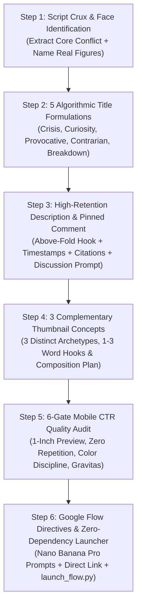

# YouTube All-Rounder 🎬🚀

[](LICENSE)
[-brightgreen.svg)](scripts/)
[](#-universal-compatibility)
[](#-zero-dependency-automation)

> The definitive, platform-agnostic **AI Agent Skill & Complete YouTube Packaging System**. Designed for **Claude Code, OpenAI Codex, OpenCode, Cursor, Gemini CLI, and Antigravity**.

Takes any raw video script, outline, or idea and transforms it into a complete, high-CTR, algorithmically optimized packaging suite:
1. **Script Conflict & Face Extraction**: Identifies narrative paradoxes and real character faces with emotional postures.
2. **5 Algorithmic Title Formulas**: Systemic Crisis, Curiosity Gap, Provocative Question, Contrarian Truth, and Definitive Breakdown.
3. **High-Retention SEO Descriptions & Pinned Comments**: Above-the-fold hook, structured chapters, citations, hashtags, and discussion-starter pinned comments.
4. **3 Complementary Thumbnail Concepts**: 3 distinct visual angles across 6 proven archetypes with punchy 1–3 word hooks.
5. **Direct Google Flow (Nano Banana Pro) Prompts**: 7-element prompt recipes with strict anti-repetition and anti-AI slop directives.
6. **Zero-Dependency One-Click Launchers**: Cross-platform Python & Bash scripts that copy prompts silently to clipboard and launch Google Flow.

---

## 📑 Table of Contents
- [🌍 Universal Compatibility](#-universal-compatibility)
- [⚡ Zero-Dependency Principle](#-zero-dependency-principle)
- [🚀 The 6-Step All-Rounder Workflow](#-the-6-step-all-rounder-workflow)
- [🎨 The 6 Signature Thumbnail Archetypes](#-the-6-signature-thumbnail-archetypes)
- [🛠️ Zero-Dependency Automation Tools](#️-zero-dependency-automation-tools)
- [⚡ The Non-Intrusive Background Principle](#-the-non-intrusive-background-principle)
- [📂 Repository Structure](#-repository-structure)
- [💻 Installation & Setup](#-installation--setup)
- [🖼️ Showcase & Case Studies](#️-showcase--case-studies)
- [🤝 Contributing](#-contributing)
- [📄 License](#-license)

---

## 🌍 Universal Compatibility

The YouTube All-Rounder is 100% portable, self-contained, and agent-agnostic. It runs seamlessly out of the box in:
*   🤖 **Claude Code** (`claude`)
*   💻 **OpenAI Codex / GPT CLI**
*   ⚡ **OpenCode**
*   🖱️ **Cursor IDE**
*   🔮 **Google Antigravity** (`agy`) / **Gemini CLI**
*   🛠️ **Any custom LLM runner or terminal shell**

---

## ⚡ Zero-Dependency Principle

No `pip install`, no heavy machine-learning packages, no bloated environments. 
- All helper utilities run exclusively on standard, built-in tools (**Python 3 standard library** and **POSIX shell**).
- Works out of the box on macOS, Linux, and Windows with zero configuration.

---

## 🚀 The 6-Step All-Rounder Workflow



### 1. Script Crux & Face Identification
Extracts the core systemic conflict and identifies the **real people/faces** (primary subject, foil, corporate rival, or representative user) with their psychological emotional posture (calculating, skeptical, stoic, hollowed-out).

### 2. 5 Algorithmic Title Formulations
Delivers 5 distinct title options targeting different viewer psychology:
*   **The Systemic Crisis**: *The Coming Data Center Power Crash*
*   **The Curiosity Gap**: *The Secret Economy Behind Your Attention*
*   **The Provocative Question**: *Did the Internet Just Run Out of Space?*
*   **The Contrarian Truth**: *Why "Free" Apps Are Making Billions Off You*
*   **The Definitive Breakdown**: *The Business of Attention: Explained*

### 3. High-Retention Description & Pinned Comment
Provides a complete, structured video metadata block:
*   **Lines 1–2 SEO Hook**: High-density summary before the "Show More" fold.
*   **Timestamps**: Clean chapter index starting at `00:00`.
*   **Key Findings**: 3–4 bulleted investigative insights.
*   **Sources & Citations**: Official filings, papers, and industry reports.
*   **Pinned Comment Hook**: High-engagement discussion question to drive comment velocity in the first 24 hours.

### 4. 3 Complementary Thumbnail Concepts
Presents 3 distinct visual angles that approach the narrative from complementary perspectives:
*   **Concept 1 (e.g. Tactical Dossier / Case File)**: Classified folders, redaction bars, paperclips, official evidence.
*   **Concept 2 (e.g. Monumental Layered Typography)**: Huge condensed woodblock typography physically mounted *behind* the subject.
*   **Concept 3 (e.g. Halftone Screenprint / Tactile Collage)**: Newsprint halftone raster dots, torn edges, physical props, crimson accents.

### 5. The 6-Gate Mobile CTR Quality Audit
Verifies every visual concept before final production:
*   **1-Inch Mobile Glancibility**: Instant comprehension at 160px width.
*   **Zero Word Repetition**: Strict prohibition on twin badges, repeated word tags, or duplicate stamps.
*   **Color Discipline**: 2–3 harmonious tones (Charcoal `#121212`, Ivory `#F4EFEA`, Crimson `#C8102E`).
*   **Authentic Gravitas**: Pensive human realism, eliminating cartoonish YouTube open-mouth reaction faces.
*   **Timestamp Safe Zone**: Bottom-right corner kept completely clear of text.

### 6. Google Flow Directives & Generation
Gives the creator ready-to-use **Nano Banana Pro** prompts and a direct link to **[Google Flow](https://labs.google/flow)** with one-click clipboard automation.

---

## 🎨 The 6 Signature Thumbnail Archetypes

Documented in detail with typography, color hex codes, and Photoshop layer stacks:

1. **The Tactical Dossier & Case File**: Classified case files, manila folders, heavy redaction marker bars, paperclips, and red rubber stamps.
2. **The Physical String Board / Crime Wall**: Mahogany or burgundy walls, jute laundry twine, wooden clothespins, polaroid grids, and red thread of fate.
3. **Halftone Screenprint & Constructivist Poster**: Ivory paper, carbon black ink, blood red typography, and prominent newsprint raster halftone dots.
4. **Double-Exposure Silhouette & Cinematic Noir**: High-contrast profile container, interior industrial scenes, and dramatic shadow play.
5. **Punk Zine & Cutout Collage**: Die-cut sticker strokes, torn paper edges, translucent duct tape, crumpled newspaper clippings, and marker defacements.
6. **The Tactical Infographic & Tech Landscape**: Heavy physical infrastructure (undersea cables, satellite orbits, subsea pipelines) paired with clean technical HUD grids and coordinates.

*For complete archetype documentation, see [references/archetypes.md](.agents/skills/youtube-all-rounder/references/archetypes.md).*

---

## 🛠️ Zero-Dependency Automation Tools

### Universal Google Flow Clipboard & Launcher
Located at `.agents/skills/youtube-all-rounder/scripts/launch_flow.py` and `launch_flow.sh`.

Copies prompt directives directly to the system clipboard across macOS (`pbcopy`), Linux (`xclip` / `wl-copy`), and Windows (`clip.exe`), then optionally opens Google Flow. **Requires zero external pip packages.**

```bash
# Standard interactive mode (copies prompt & opens browser)
python3 .agents/skills/youtube-all-rounder/scripts/launch_flow.py prompt.txt

# Non-intrusive background mode (copies silently without opening browser)
python3 .agents/skills/youtube-all-rounder/scripts/launch_flow.py --copy-only prompt.txt

# Or using Bash
./.agents/skills/youtube-all-rounder/scripts/launch_flow.sh prompt.txt
```

---

## ⚡ The Non-Intrusive Background Principle

The engine strictly respects user productivity:
*   **Never steals active window focus** or locks the user's mouse cursor.
*   Supports `--copy-only` / `--background` modes for automated background pipelines.
*   Asset generation and clipboard actions execute quietly without interrupting active editing, coding, or browsing.

---

## 📂 Repository Structure

```text
.
├── .agents/
│   └── skills/
│       └── youtube-all-rounder/
│           ├── SKILL.md                              # Universal agent instruction & 6-step flow
│           ├── scripts/
│           │   ├── launch_flow.py                    # Zero-dependency Python prompt clipboard & launcher
│           │   └── launch_flow.sh                    # POSIX bash clipboard & launcher
│           ├── references/
│           │   ├── archetypes.md                     # Deep dive into all 6 visual archetypes
│           │   └── typography-and-color.md           # Exact fonts, kerning rules, and hex color codes
│           ├── resources/
│           │   ├── prompt-templates.md               # Google Flow (Nano Banana Pro) prompt recipes
│           │   ├── photoshop-compositing-runbook.md  # 6-group master layer stack & filter settings
│           │   └── seo-and-packaging-guide.md        # 5 title formulas, descriptions & pinned comments
│           └── checklists/
│               └── thumbnail-audit-checklist.md      # 6-gate mobile 1-inch preview & CTR audit
├── thumbnails/                                       # Production-grade 2K showcase assets
│   ├── README.md                                     # Catalog index of case studies & designs
│   └── case-studies/
│       ├── 01-attention-economy/                     # "The Business of Your Attention" thumbnails
│       └── 02-internet-infrastructure/               # "The Internet Is Running Out of Space" thumbnails
├── CONTRIBUTING.md                                   # Contribution guidelines
├── LICENSE                                           # MIT Open Source License
├── .gitignore                                        # Clean repository ignore rules
└── README.md                                         # This documentation
```

---

## 💻 Installation & Setup

### 1. Direct Project Setup
Clone this repository directly into your video production or creative project:
```bash
git clone https://github.com/youtube-all-rounder/youtube-all-rounder.git .
```
*(No `pip install` needed - runs on pure Python standard library!)*

### 2. Antigravity / Gemini CLI Setup
Symlink or copy the skill folder into your agent's skills directory:
```bash
mkdir -p ~/.gemini/config/skills/
cp -r .agents/skills/youtube-all-rounder ~/.gemini/config/skills/
```

### 3. Claude Code / Codex / OpenCode Setup
Ensure the `.agents/skills/youtube-all-rounder/` directory is present in your workspace root. Your agent will automatically discover and load `SKILL.md`.

Whenever you share any video script, outline, or idea, invoke:
> *"Package this video script using youtube-all-rounder"*

---

## 🖼️ Showcase & Case Studies

Explore the [thumbnails/README.md](thumbnails/README.md) catalog to see production 2K outputs generated with this engine:
- **Case Study 1: The Attention Economy** (`THE CASINO`, `THE LOOP`, `YOU ARE THE PRODUCT`, `CAGED`, `THE TRAP`, `TRAPPED`).
- **Case Study 2: Physical Cloud Infrastructure** (`OVERLOAD`, `GRIDLOCK`, `OUT OF SPACE`).

---

## 🤝 Contributing

Contributions are welcome! Please read [CONTRIBUTING.md](CONTRIBUTING.md) for details on adding new visual archetypes, refining prompt formulas, and optimizing helper scripts.

---

## 📄 License

This project is licensed under the [MIT License](LICENSE) - free to use, modify, and distribute for personal or commercial YouTube channels.
