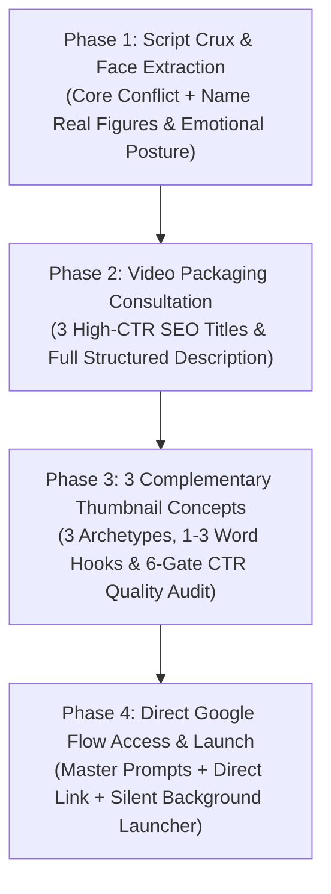

# Universal YouTube Packaging & Documentary Thumbnail Engine 🎬🔍

[](LICENSE)
[](requirements.txt)
[](#-works-across-any-ai-coding-agent)
[](#-automated-tools--scripts)

> An elite, platform-agnostic **AI Agent Skill & Complete YouTube Packaging System** designed for **Claude Code, OpenAI Codex, OpenCode, Cursor, Gemini CLI, and Antigravity**.

Takes raw video scripts, identifies narrative tension and core paradoxes, extracts the real human figures to anchor the visual, generates **SEO-friendly high-CTR titles and descriptions**, presents **3 complementary thumbnail concepts**, and gives creators **direct access to Google Flow** with hyper-detailed **Nano Banana Pro** prompts.

---

## 📑 Table of Contents
- [🌍 Works Across Any AI Coding Agent](#-works-across-any-ai-coding-agent)
- [🚀 The 4-Phase Packaging Workflow](#-the-4-phase-packaging-workflow)
- [🎨 The 6 Visual Archetypes](#-the-6-visual-archetypes)
- [🛠️ Automated Tools & Scripts](#️-automated-tools--scripts)
  - [1. Automated SynthID / Gemini Watermark Inpainter](#1-automated-synthid--gemini-watermark-inpainter)
  - [2. Universal Google Flow Clipboard & Launcher](#2-universal-google-flow-clipboard--launcher)
- [⚡ The Non-Intrusive Background Principle](#-the-non-intrusive-background-principle)
- [📂 Repository Structure](#-repository-structure)
- [💻 Installation & Agent Setup](#-installation--agent-setup)
- [🖼️ Showcase & Case Studies](#️-showcase--case-studies)
- [🤝 Contributing](#-contributing)
- [📄 License](#-license)

---

## 🌍 Works Across Any AI Coding Agent

This engine is 100% portable and does not rely on proprietary internal image generation tools. It works out of the box in:
*   🤖 **Claude Code** (`claude`)
*   💻 **OpenAI Codex / GPT CLI**
*   ⚡ **OpenCode**
*   🖱️ **Cursor IDE**
*   🔮 **Google Antigravity** (`agy`) / **Gemini CLI**
*   🛠️ **Any custom LLM tool runner or terminal shell**

---

## 🚀 The 4-Phase Packaging Workflow



### 1. Understand Script & Identify Faces
The agent reads the script, finds the core paradox, and specifically extracts the **real human faces** (e.g. Jensen Huang, Alice Huang, Elon Musk, Mark Zuckerberg, or anonymous smartphone user) and their psychological posture (calculating, skeptical, stoic, hollowed-out).

### 2. Present Title & Description
Delivers 3 high-CTR SEO title angles (Systemic Crisis, Investigative Curiosity, Provocative Ultimatum) and a high-retention video description with timestamps, key findings, and citations.

### 3. Present 3 Complementary Thumbnail Concepts & Quality Gate
Gives the creator 3 distinct visual angles that approach the video's core idea from complementary psychological perspectives:
1. **The Tactical Dossier** (Hook: `THE TRAP` / `WHO KNEW?` — Classified case file, paperclips, red stamps).
2. **The Halftone Screenprint** (Hook: `YOU ARE THE PRODUCT` — Risograph newsprint halftone, blood red typography).
3. **The Tactile Collage / Casino** (Hook: `THE CASINO` — Distressed mixed media, 3D slot reels, torn portrait, red hazard tape).

#### The High-CTR Beauty & Clickability Gate:
*   **Zero Word Repetition**: Prompts strictly mandate single-instance text hooks to prevent AI hallucinations like double badges (`TRAPPED TRAPPED`).
*   **1.2-Second Mobile Glancibility**: Instant visual comprehension at 160px width.
*   **Curiosity Gap**: Irresistible visual tension without misleading clickbait.
*   **Color Discipline**: Restrained 2–3 color harmony (Charcoal, Ivory, Crimson Red).

### 4. Direct Google Flow Access & Generation
Gives the creator direct access to **Google Flow**:
*   A ready-to-paste **Nano Banana Pro Master Prompt** for each concept.
*   Direct clickable link to **Google Flow**: [https://labs.google/flow](https://labs.google/flow).
*   One-click cross-platform copy & launch script (`./scripts/launch_flow.sh` or `python3 ./scripts/launch_flow.py`).

---

## 🎨 The 6 Visual Archetypes

Documented in detail with typography, color hex codes, and Photoshop layer stacks:

1. **The Tactical Dossier & Case File**: Classified case files, manila folders, heavy redaction marker bars, paperclips, and red rubber stamps.
2. **The Physical String Board / Crime Wall**: Mahogany or burgundy walls, jute laundry twine, wooden clothespins, polaroid grids, and red thread of fate.
3. **Halftone Screenprint & Constructivist Poster**: Ivory paper, carbon black ink, blood red typography, and prominent newsprint raster halftone dots.
4. **Double-Exposure Silhouette & Cinematic Noir**: High-contrast profile container, interior industrial scenes, and dramatic puppet master shadow play.
5. **Punk Zine & Cutout Collage**: Die-cut sticker strokes, torn paper edges, translucent duct tape, crumpled newspaper clippings, and marker defacements.
6. **The Tactical Infographic & Tech Landscape**: Heavy physical infrastructure (undersea cables, satellite orbits, subsea pipelines) paired with clean technical HUD grids and coordinates.

*For complete archetype documentation, see [references/archetypes.md](.agents/skills/documentary-thumbnail-engine/references/archetypes.md).*

---

## 🛠️ Automated Tools & Scripts

### 1. Automated SynthID / Gemini Watermark Inpainter
Located at `.agents/skills/documentary-thumbnail-engine/scripts/remove_watermark.py`.

Uses mathematical **OpenCV Telea inpainting** (`cv2.INPAINT_TELEA`) and morphological dilation to seamlessly detect and erase the 4-pointed sparkle watermark from Google Flow / Imagen generations. Restores native film grain and background textures with zero blurring or seams.

```bash
# Clean a single thumbnail (overwrites in place)
python3 .agents/skills/documentary-thumbnail-engine/scripts/remove_watermark.py thumbnail.jpg

# Clean and output to a specific file or folder
python3 .agents/skills/documentary-thumbnail-engine/scripts/remove_watermark.py raw.jpg -o cleaned.jpg

# Batch clean an entire directory of images
python3 .agents/skills/documentary-thumbnail-engine/scripts/remove_watermark.py ./renders/ -o ./clean_renders/
```

### 2. Universal Google Flow Clipboard & Launcher
Located at `.agents/skills/documentary-thumbnail-engine/scripts/launch_flow.py` and `launch_flow.sh`.

Copies prompt directives directly to the system clipboard across macOS (`pbcopy`), Linux (`xclip` / `wl-copy`), and Windows (`clip.exe`), then optionally opens Google Flow.

```bash
# Standard interactive mode (copies prompt & opens browser)
python3 .agents/skills/documentary-thumbnail-engine/scripts/launch_flow.py prompt.txt

# Non-intrusive background mode (copies silently without opening browser)
python3 .agents/skills/documentary-thumbnail-engine/scripts/launch_flow.py --copy-only prompt.txt

# Or using Bash
./.agents/skills/documentary-thumbnail-engine/scripts/launch_flow.sh prompt.txt
```

---

## ⚡ The Non-Intrusive Background Principle

The engine strictly respects user productivity:
*   **Never steals active window focus** or locks the user's mouse cursor.
*   Supports `--copy-only` / `--background` modes for background pipelines.
*   Asset extractions run quietly via direct downloads or cache reads without interrupting active browsing or coding sessions.

---

## 📂 Repository Structure

```text
.
├── .agents/
│   └── skills/
│       └── documentary-thumbnail-engine/
│           ├── SKILL.md                              # Universal agent instruction & 4-phase flow
│           ├── scripts/
│           │   ├── launch_flow.py                    # Cross-platform prompt clipboard & Flow launcher
│           │   ├── launch_flow.sh                    # Bash clipboard & Flow launcher
│           │   └── remove_watermark.py               # Automated OpenCV Telea watermark inpainter
│           ├── references/
│           │   ├── archetypes.md                     # Deep dive into all 6 visual archetypes
│           │   └── typography-and-color.md           # Exact fonts, kerning rules, and hex color codes
│           ├── resources/
│           │   ├── prompt-templates.md               # Google Flow (Nano Banana Pro) prompt recipes
│           │   ├── photoshop-compositing-runbook.md  # 6-group master layer stack & filter settings
│           │   └── seo-and-packaging-guide.md        # YouTube title formulas, descriptions & tag strategy
│           └── checklists/
│               └── thumbnail-audit-checklist.md      # 6-gate mobile 1-inch preview & CTR audit
├── thumbnails/                                       # Production-grade 2K showcase assets
│   ├── README.md                                     # Catalog index of case studies & designs
│   └── case-studies/
│       ├── 01-attention-economy/                     # "The Business of Your Attention" thumbnails
│       └── 02-internet-infrastructure/               # "The Internet Is Running Out of Space" thumbnails
├── CONTRIBUTING.md                                   # Contribution guidelines
├── LICENSE                                           # MIT Open Source License
├── requirements.txt                                  # Python dependencies (opencv-python, numpy, Pillow)
├── .gitignore                                        # Clean repository ignore rules
└── README.md                                         # This documentation
```

---

## 💻 Installation & Agent Setup

### 1. Direct Project Setup
Clone this repository directly into your video production or creative project:
```bash
git clone https://github.com/ursishant/documentary-thumbnail-engine.git .
pip install -r requirements.txt
```

### 2. Antigravity / Gemini CLI Setup
Symlink or copy the skill folder into your agent's skills directory:
```bash
mkdir -p ~/.gemini/config/skills/
cp -r .agents/skills/documentary-thumbnail-engine ~/.gemini/config/skills/
```

### 3. Claude Code / Codex / OpenCode Setup
Ensure the `.agents/skills/documentary-thumbnail-engine/` directory is present in your workspace root. Your agent will automatically discover and load `SKILL.md`.

Whenever you provide a video script or topic, invoke:
> *"Package this video script using documentary-thumbnail-engine"*

---

## 🖼️ Showcase & Case Studies

Explore the [thumbnails/README.md](thumbnails/README.md) catalog to see production 2K outputs generated with this engine:
- **Case Study 1: The Attention Economy** (`THE CASINO`, `THE LOOP`, `YOU ARE THE PRODUCT`, `CAGED`, `THE TRAP`).
- **Case Study 2: Physical Cloud Infrastructure** (`OVERLOAD`, `GRIDLOCK`, `OUT OF SPACE`).

---

## 🤝 Contributing

Contributions are welcome! Please read [CONTRIBUTING.md](CONTRIBUTING.md) for details on adding new visual archetypes, refining prompt formulas, and optimizing helper scripts.

---

## 📄 License

This project is licensed under the [MIT License](LICENSE) - feel free to use, modify, and distribute for personal or commercial YouTube channels.
